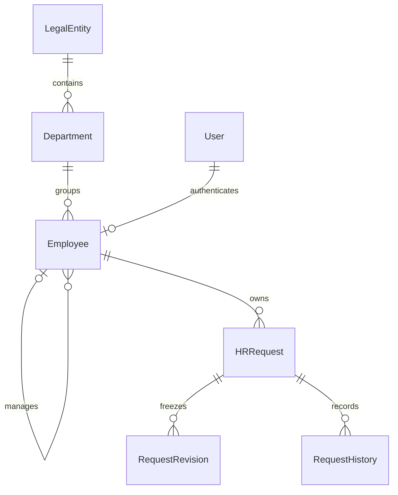
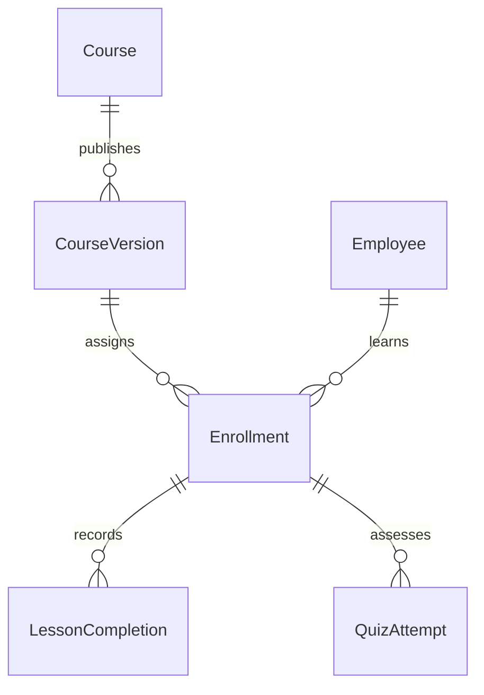
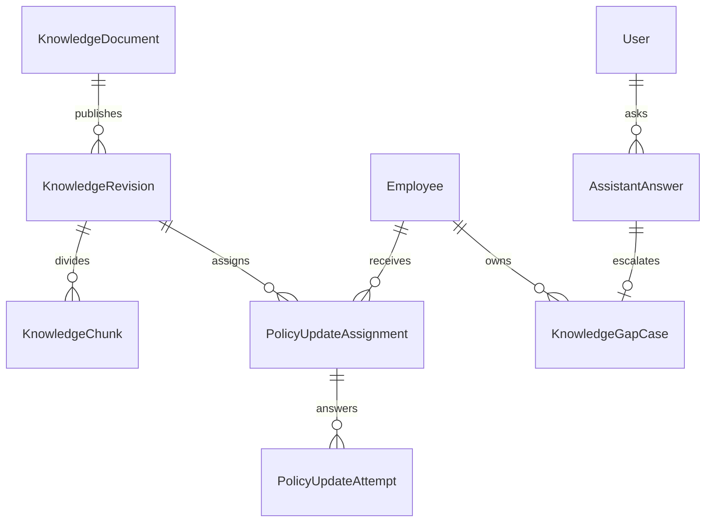
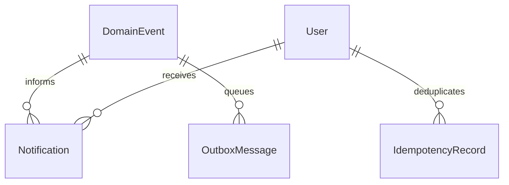
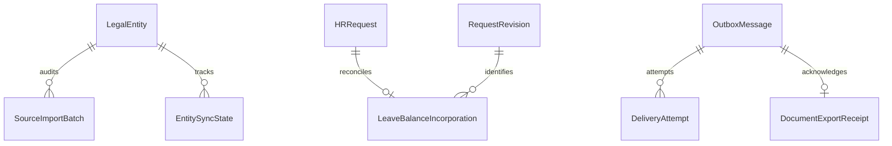

# Модель данных и проверяемые границы

Схема создаётся Django migrations. Диаграммы ниже объясняют отношения и владельцев данных; точные поля находятся в моделях и OpenAPI. Это не параллельный handwritten SQL schema.

## Люди и заявления

User управляет входом и бизнес-ролью. Employee хранит кадровые факты, source identity и свежесть импорта. Один не подменяет другого: сохранённая учётная запись может потерять активный кадровый профиль.

HRRequest владеет маршрутом, version и полями выбранного kind. RequestRevision фиксирует отправленный payload и назначенного руководителя. RequestHistory фиксирует событие решения с actor, переходом и номером отправки. Возврат и новая отправка создают следующую revision; существующая не редактируется.

Менеджер связан с сотрудником, а не со строкой ФИО. Изменение имени не меняет identity. Контроль одного юрлица и отсутствие циклов применяются к структуре; массовый импорт сериализуется по юрлицу, чтобы два пакета не образовали цикл между строками.

## Обучение

Course содержит изменяемый draft и указатель на текущую опубликованную версию. CourseVersion хранит проверенные снимки уроков и вопросов, порог и правила попыток. JSON выбран для целиком публикуемого документа; transport/content validators проверяют уникальные ids, варианты, правильные ответы и обязательный материал до публикации.

Enrollment ссылается на конкретную версию. LessonCompletion хранит факт завершения lesson id этой версии. QuizAttempt хранит вопросы, полученные ответы и рассчитанный результат. Learner serializer исключает answer keys. Новая публикация не изменяет историю и не переводит сотрудника на другой тест без нового назначения.

Доступность курса, срок назначения, начало, прохождение материала и успех теста — самостоятельные состояния. Из них строятся фильтры и summary. Успех не определяется произвольным клиентским процентом.

## Регламенты, ответы и вопросы HR

Revision содержит аудиторию, язык, владельца и сроки действия опубликованного документа. Доступ фильтруется до retrieval. Ответ хранит server-owned ссылки на разрешённые фрагменты и проверенные claims. При повторном открытии доступ проверяется заново, поэтому сохранённый ответ не обходит отзыв документа.

KnowledgeGapCase создаётся явным действием сотрудника. Это внутреннее обращение со своей version, состоянием и ответом HR. Его создание не отправляет email или сообщение в сторонний мессенджер. Вопрос сотрудника не становится опубликованным регламентом.

PolicyUpdateAssignment связывает активного сотрудника с опубликованной редакцией. HR вручную задаёт проверочный вопрос в черновике регламента. KnowledgeRevision хранит предыдущую редакцию и правильный вариант; API ответа сотрудника возвращает только вопрос и варианты. Неудачная попытка остаётся в ожидании, успешная завершает назначение. Новый изменённый текст закрывает прежние незавершённые назначения как superseded.

## Событие, уведомление и доставка

DomainEvent, история, Notification и OutboxMessage сохраняются в той же транзакции, что бизнес-переход. Уведомление имеет read_at получателя. Outbox имеет техническое состояние доставки. IdempotencyRecord привязан к actor и ключу, хранит hash команды и её исходный ответ.

Ни прочитанное уведомление, ни зарегистрированный экспорт не заменяют человеческое согласование. Повтор команды проверяет разрешение перед replay. Повтор доставки использует постоянный ключ получателя, хотя lease конкретной попытки меняется.

## Подтверждение источника и восстановление доставки

SourceImportBatch сохраняет принятый или отклонённый нормализованный пакет. EntitySyncState хранит текущую source revision. LeaveBalanceIncorporation — изменяемая проекция включения согласованного отпуска в официальный остаток; неизменяемые импортные пакеты сохраняют подтверждения и обратные корректировки. Это часть HR-проекции, а не доказательство доставки документа.

DeliveryAttempt хранит номер и claim token попытки, DeliveryAttemptResult — её неизменяемый исход. DocumentExportReceipt подтверждает доставку со стороны приложения, MockDocumentReceipt сохраняет независимое подтверждение учебного получателя. Успешная квитанция означает принятие учебного документа и отделена от согласования, выплаты и учёта отпуска.

## Инварианты по уровням

| Инвариант | Где обеспечивается |
| --- | --- |
| Уникальный логин, external id, assignment/version identity | Ограничения БД и framework |
| Корректный kind и набор полей заявления | Strict serializers, application validation, CHECK constraints |
| Чужие данные не попадают в список и detail | Scoped selectors перед фильтрами и пагинацией |
| Право действия соответствует текущей структуре | Application command после row lock |
| Одновременные отпуска не обходят пересечение/остаток | Сериализация по Employee в PostgreSQL |
| Два решения одной version не создают два экспорта | Optimistic version, row lock, атомарный outbox |
| Один intent не создаёт два эффекта | Actor/key unique, payload hash и транзакционный receipt |
| Опубликованная версия не редактируется через приложение | AppendOnly model/queryset, read-only admin, отдельный draft |
| Правильный ответ теста не выдаётся учащемуся | Отдельные learner serializers и серверная оценка |
| Ограниченный регламент не участвует в ответе | ACL/effectivity до retrieval и повторная авторизация цитаты |
| Импортированный баланс не вычитается дважды | Явное source confirmation/reversal, отдельное от Documentolog |
| Старая worker-попытка не подтверждает новую lease | Claim token/fencing и повторяемая provider identity |

У application append-only есть явная граница: это защита публичных commands, model/queryset и admin, не криптографический журнал и не запрет действиям владельца БД. Для production с отдельной моделью угроз дополнительно определяются DB roles, аудит оператора, backup retention и проверка восстановления.

## Границы транзакций

Заявки сначала блокируют Employee, затем HRRequest. Это общий порядок для проверки пересечения и финального решения. Import сериализует пакет по юрлицу и блокирует затронутые кадровые записи. Academy блокирует публикацию/назначение и конкретное enrollment для изменения прогресса. Обязательные события не откладываются до ненадёжного процесса после response.

Внешний вызов Documentolog выполняется worker после commit решения. Его сетевое ожидание не удерживает lock согласования. Доставка имеет собственную историю попыток. Генерация AI ограничена timeout провайдера; её отсутствие не должно блокировать остальные кадровые сценарии.

При объединении новых команд проверять порядок блокировок по затрагиваемым агрегатам. Название `transaction.atomic` само по себе не доказывает отсутствие race или deadlock; это проверяется конкурентным сценарием PostgreSQL.
