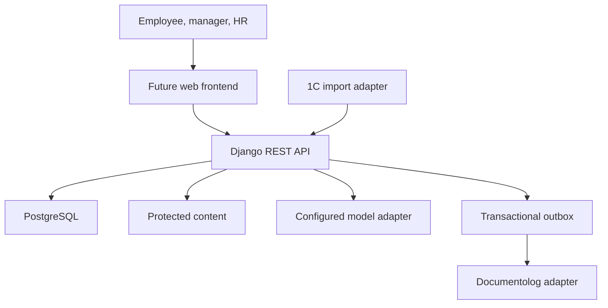
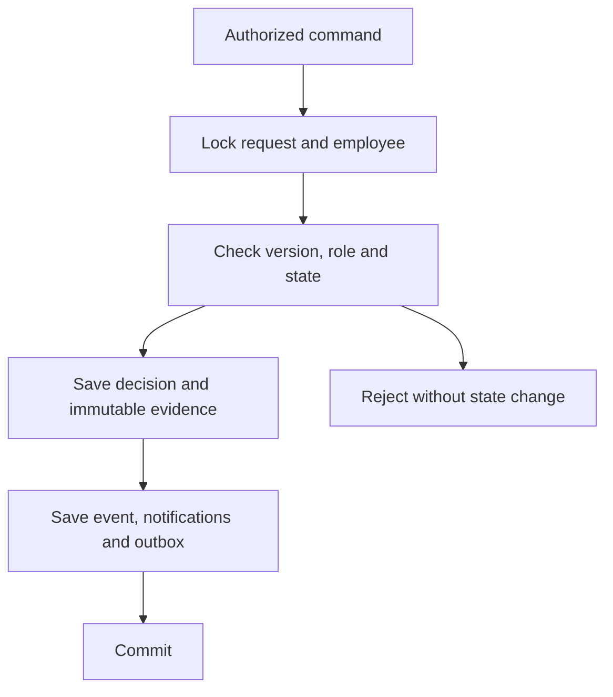

# System architecture

## Decision

JanaMen uses one modular Django backend and PostgreSQL. An independent frontend consumes generated OpenAPI contracts.
The backend has a common identity and transactional data model for requests, learning and knowledge.
The choice reuses mature framework capabilities while retaining ownership of JanaMen's employee experience.

See [reuse decision](reuse-decision.md) for the product-level alternatives and source evidence.
See [backend contract](backend-contract.md) for exact module interfaces.

## Context

The web frontend is a separate delivery. Protected document access goes through an authorization check.
The adapter boxes identify integration boundaries. Mock implementations are explicit and do not assert a connection to a real company system.

## Module ownership

| Module | Owns | May read or call |
| --- | --- | --- |
| identity | Users, company structure, imported employee facts, visibility rules | Django authentication |
| hr_requests | Request aggregate, snapshots, decisions, projections | Identity scope, core events, notifications |
| academy | Catalogue, versions, assignments, lesson progress, quiz attempts | Identity scope, core events, notifications |
| knowledge | Published documents, chunks, answers, citations, HR cases | Identity scope, model/retrieval adapters, core events |
| notifications | Per-user event messages and read state | Identity user reference, core event reference |
| integrations | Source snapshots, export receipts, retry commands | Explicit request/profile import/export services |
| workbench | Read projection of personal work, scoped review queues and full counts | Existing identity, requests, Academy, knowledge and notification selectors |
| core | UUID/timestamps, errors, audit events, idempotency and outbox | Django transaction facilities |

A domain module keeps related rules together. API views parse input and call a command.
A command owns the transaction needed for its invariant.
The ORM is the persistence interface. Extra repository wrappers must demonstrate a need such as a real alternate store.

## Employee data ownership

1C owns employment facts and official leave balance.
JanaMen stores imported values with freshness metadata.
A portal approval cannot silently modify an official fact.
A projection explains the effects of portal requests without overwriting the imported baseline.
The normalized mock source explicitly lists approved leave requests already included in each employee balance. JanaMen records the exact immutable request revision and days in LeaveBalanceIncorporation. Subsequent snapshots reaffirm those ids; removing an inclusion requires an explicit reversal with a reason. A real 1C connector must map its own accounting evidence to this contract. A Documentolog delivery receipt supplies no evidence that a leave balance changed.

This separation prevents double subtraction of leave during synchronization.

Workbench reuses these calculated balances and existing resource serializers. It combines personal work and the caller's permitted review queues without creating another mutable task store. See [workbench contract](workbench.md) for ordering, count semantics and excluded information.

## Request transaction

A successful response means the transaction committed.
An external exporter runs after this transaction.
The exporter retries with an idempotency identity. Delivery failure is visible while the human decision remains intact.
Do not use a network call inside the approval transaction as a substitute for durable export tracking.

## State dimensions

| Entity | Independent dimensions |
| --- | --- |
| HR request | Business status, optimistic version, submitted revision, export delivery status |
| Learning | Course availability, assigned version, material completion, assessment success, due status |
| Policy | Publication status, effective revision, audience, retrieval relevance |
| Assistant response | Evidence sufficiency, provider availability, response mode, citation validity |
| Notification | Business event identity, delivery/read state |

One ambiguous status field cannot safely encode every dimension.
The frontend must label each relevant dimension where it changes the next action.

## Security boundaries

Django sessions identify the actor. CSRF protection applies to login and every unsafe session request.
All API input is untrusted, including ids and employee ownership fields.
Read scopes apply before list filtering and before knowledge retrieval.
Write scopes are checked again by the command that performs the action.
A user's ability to see a record is not sufficient permission to decide it.

The model adapter receives only allowed retrieved excerpts. It receives neither session credentials nor unrestricted database access.
Citation ids resolve server-owned records. Model-authored URLs are not accepted as proof.
The assistant does not issue HR mutation commands.

## Error and retry boundaries

A validation error leaves data unchanged.
A stale version or conflicting idempotency key produces a 409 with a recoverable explanation.
A missing/hidden object produces a 404.
A dependency failure produces a separate state or 503 where the operation cannot proceed.
An outbox failure retains retry state and error context appropriate for the operator.

Do not log passwords, session cookies, model API keys or entire private prompts.
Use a request id for correlation and a domain event id for business history.

## Deployment shape

The intended local deployment contains a web process, PostgreSQL and an outbox worker.
Use a persistent database volume and a non-root application process.
A reverse proxy terminates HTTPS and exposes the frontend/API on the same origin in a hosted environment.
Configuration is supplied through environment files excluded from Git.
Startup validates required production settings.

The cloud workspace may lack Docker or a model provider. Verification records distinguish a generated configuration from an executed container or generated-model test.

## Design alternatives

### Full HR suite plus LMS

A mature HR system owns employees, balances, leave settings and finance-oriented records.
A separate LMS adds course and learner behavior.
A custom frontend must connect both identities and policies while reconciling their assumptions with 1C.

This path is valid when those products' data ownership and workflows match the intended system.
For JanaMen, official data is imported and read-only, and salary advance semantics need to stay distinct from expense accounting.

### Content backend plus custom workflow

Payload supplies authentication, content editing and an admin interface.
A custom layer owns employee hierarchy, approval transitions and learner evidence.
This can be a strong TypeScript design. Its access and transaction behavior must be pinned to the chosen release and explicitly tested.

### Selected modular backend

Django supplies identity machinery, relational persistence, transactions and administration.
DRF supplies typed validation and API integration points.
JanaMen implements its own small number of domain aggregates on top.
A separate frontend can be designed without exposing the admin interface to every employee.

The deciding factors are shared invariants and source ownership, not the cost of an extra programming language or an assumed short deadline.

## Similarity to MIS Pro

The user's earlier MIS Pro project is a medical-organization accreditation workflow.
Its architecture shares role-dependent work, requests, immutable submitted evidence, decisions, history and a separate frontend.
Those are useful structural precedents for JanaMen.

JanaMen adds employee employment snapshots, leave/advance semantics, learning assignments and knowledge retrieval.
The application domain and its permissions must be modeled explicitly rather than renamed from the accreditation workflow.
This repository contains newly written implementation and public-source research. It does not redistribute the private MIS Pro source.

