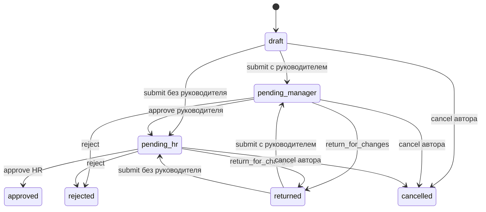

# Состояния, команды и отображение данных

Статус: спецификация интерфейса на основе [backend contract](../architecture/backend-contract.md), 17 октября 2026 года. Транспортные имена и возможности сверяются с актуальным OpenAPI. Этот документ не является второй схемой API.

## Заявка имеет одну текущую стадию и историю версий

| Серверный статус | Русская подпись | Смысл для автора | Потенциальное действие интерфейса |
| --- | --- | --- | --- |
| `draft` | Черновик | Запись ещё не подана | Изменить, сохранить, отправить, отменить по разрешениям |
| `pending_manager` | На рассмотрении руководителя | Ожидается решение назначенного руководителя | Автор отслеживает или отменяет. Разрешённый проверяющий принимает решение |
| `pending_hr` | На рассмотрении HR | Ожидается решение HR | Автор отслеживает или отменяет. Разрешённый HR принимает решение |
| `approved` | Согласовано | Предметный процесс согласования завершён | Смотреть результат и историю. Не предлагать незадокументированную отмену |
| `rejected` | Отклонено | Зафиксирован отказ и его основание | Смотреть решение. Новый запрос оформляется отдельно, если это разрешено |
| `returned` | Требует исправления | Проверяющий запросил изменение данных | Прочитать причину, изменить и повторно отправить по `allowed_actions` |
| `cancelled` | Отменено | Автор прекратил доступный ему незавершённый процесс | Смотреть историю |

Набор кнопок приходит из `allowed_actions`. Таблица объясняет смысл состояния, но не выдаёт право на команду. Клиент не вычисляет согласующего только по своей роли. Условия доступа проверяет сервер для конкретной версии.

Схема относится к демонстрационной политике. Она не утверждает реальный процесс Jana Post. Дополнительная отмена возвращённой заявки возможна только при наличии соответствующего разрешения API. Для уже согласованного заявления отдельный процесс отмены пока не определён.

### Поданная версия не меняется незаметно

Деталь показывает текущий этап, поданные сведения и хронологическую историю. Возврат на исправление сохраняет прежний snapshot и замечание. Повторная подача создаёт новую версию.

У каждой записи истории есть действие, участник при доступности, время и относящееся пояснение. История не подменяется оптимистическими событиями браузера. Новый комментарий или кнопка не считается сохранённым действием до ответа сервера.

При сравнении версий сначала показываются изменённые предметные поля. Для отпуска это даты и причина. Для аванса это сумма, валюта, дата и причина. Полный журнал остаётся доступным. Если API пока не даёт сравнение, frontend может сравнить разрешённые snapshots без изменения источника истины.

### Повтор и конфликт имеют разные причины

При начале команды клиент сохраняет локальное состояние pending и использованный `Idempotency-Key`. Повтор той же отправки после неопределённого сетевого результата использует тот же ключ и тот же payload. Новое намерение пользователя получает новый ключ. Серверная версия передаётся как expected version в предусмотренном API поле.

При 409 клиент прекращает автоматические повторы. Он получает актуальную разрешённую запись и сообщает, что она изменилась. Данные формы сохраняются в памяти текущего экрана, чтобы пользователь мог сопоставить их с новой версией. Не применяйте прежнее согласование автоматически к новому содержанию.

Если результат команды неизвестен из-за обрыва сети, текст не должен утверждать ни успех, ни провал. Подходящая формулировка: "Не удалось получить результат. Проверяем состояние заявки". Последующий повтор допустим только по согласованным правилам идемпотентности.

### Баланс, одобрение и доставка

Официальный `leave_balance` является импортированным фактом. Рядом показывается `balance_as_of`. Прогноз для выбранных дат имеет отдельное название и указанное правило подсчёта. Портал не выдаёт демонстрационный подсчёт за норму трудового законодательства.

`approved` означает завершённое согласование. Этот статус не означает выплату аванса, подписание ЭЦП, создание юридически значимого архива или успешную доставку в Documentolog. Доставка и её ошибка показываются отдельным разрешённым получателю сообщением.

## У обучения несколько независимых состояний

| Ось | Источник | Допустимая интерпретация |
| --- | --- | --- |
| Каталог | Публикация и доступность Course | Доступен, не опубликован или архивирован согласно модели |
| Версия | Неизменяемая CourseVersion | На каком материале и правилах основано назначение |
| Назначение | Enrollment | Кому, кем и с какой обязательностью назначен курс |
| Начало и завершение | `started_at`, `completed_at` и серверные факты | Не начато, начато, завершено |
| Материал | Серверный lesson progress | Какие обязательные уроки подтверждены |
| Попытка | Серверный результат QuizAttempt | Как завершилась конкретная попытка, её дата и версия |
| Срок | `due_at` и время проверки | Просрочено ли незавершённое назначение |
| Возможное действие | Доступность и разрешённая команда | Начать, продолжить, отправить ответы или посмотреть результат |

В интерфейсе дата, обязательность и неудачная попытка являются отдельными сведениями. Они не превращаются в новый общий статус вроде `failed_overdue_required`. У списка может быть фильтр "Есть неуспешная попытка". Фильтр не должен скрывать последующий успех, если человек смотрит историю попыток.

### Определения производных представлений

| Представление | Определение для интерфейса |
| --- | --- |
| Назначено | Разрешённые назначения текущему сотруднику. Обязательность отображается отдельно |
| Не начато | Нет факта начала и завершения. Серверное представление имеет приоритет перед локальным предположением |
| В процессе | Есть начало, нет завершения |
| Завершено | Есть серверный факт завершения |
| Просрочено | Назначение не завершено, срок существует и уже прошёл |
| Нужно повторить тест | Последняя релевантная попытка неуспешна и повтор разрешён правилами версии |
| История | Завершённые назначения и их попытки, включая разрешённые архивные версии |

Прошедший `due_at` сам по себе не блокирует материал. Для запрета доступа нужна отдельная причина. Прежняя неуспешная попытка не отменяет последующий успех. Архивирование курса не удаляет завершение.

Успешный тест и прочтение всех уроков учитываются по правилам версии. Frontend не устанавливает `score`, `progress`, `completed_at` или владельца назначения. Кнопка "Завершить урок" вызывает предметную серверную команду. Результат завершения приходит от неё.

### Плеер и попытка

Плеер показывает положение в курсе и явный способ вернуться к списку. Пользователь может понять, какие части сохранены. Кнопки навигации не меняют историю без команды. У сохранения есть pending, успех и исправимая ошибка.

Перед тестом доступны опубликованные правила. Во время теста видны выбранные ответы и оставшиеся без ответа вопросы. После отправки показывается результат сервера. Повторная отправка не создаёт случайную вторую попытку.

Смена маршрута во время незавершённой попытки обрабатывается по контракту хранения черновика. Если сервер не сохраняет промежуточные ответы, интерфейс честно предупреждает о потере текущих несданных ответов. Не обещайте автоматическое восстановление или offline-сдачу без реализации.

## AI Jana сообщает реальный режим ответа

| Режим | Понятное сообщение | Что пользователь может сделать | Чего интерфейс не утверждает |
| --- | --- | --- | --- |
| `generated` | Подбор полных предложений из разрешённых источников; `answer_strategy=source_bound_selection` | Прочитать выбранные формулировки и открыть источник с версией | Что это свободный пересказ, исчерпывающий ответ или независимая проверка истинности самого регламента |
| `extractive` | Найдены фрагменты регламентов | Прочитать фрагменты и открыть документ | Что это свободно сгенерированная консультация модели |
| `insufficient_evidence` | В доступных регламентах не найдено достаточного ответа | Уточнить вопрос или явно обратиться в HR | Что правила не существует вообще или что можно придумать подходящий ответ |
| `provider_unavailable` | Сейчас не удалось получить ответ помощника | Повторить или открыть доступные документы | Что произошёл отказ по содержанию вопроса |

Если сервис при недоступном провайдере возвращает извлечённые фрагменты, он сообщает режим `extractive`. Интерфейс показывает именно полученный результат. Не переименовывайте такой ответ в `generated` ради демонстрации.

В реализованной стратегии генерации сервер принимает только полные предложения, совпадающие с разрешённым фрагментом источника. Он проверяет ссылки, текст, числа и отрицания. Одной существующей ссылки недостаточно для принятия произвольного утверждения. Режим `extractive` имеет `answer_strategy=ranked_excerpts`, отказ — `refusal`, сбой провайдера — `unavailable`. Свободный синтез ответа потребует отдельной стратегии и проверки качества.

Ссылка на источник содержит разрешённые сервером идентификаторы. Рядом доступны название, раздел и ревизия. Сотрудник видит основание соответствующей части ответа. Процент "уверенности" не показывается как гарантия, если система не имеет проверенной калибровки такого числа.

При открытии документа доступ проверяется повторно. Отозванный источник не извлекается из клиентского кеша для обхода запрета. Историческая ревизия отображается как историческая, только если её просмотр разрешён. В остальных случаях показывается понятная недоступность и путь к актуальным разрешённым материалам.

Обращение HR создаётся отдельным подтверждённым действием. Перед созданием человек видит вопрос и контекст, который будет передан. Отказ от обращения ничего не отправляет. Созданное обращение имеет собственный идентификатор и состояние. AI не принимает кадрового решения и не меняет заявку.

Вопросы и документы могут содержать текст, похожий на инструкции модели. Такой текст не становится полномочием менять источник, доступ или действия пользователя. Проверка prompt injection относится к backend и модели. Интерфейс не является защитой за счёт предупреждающей надписи.

## Уведомления и домашние задачи

Непрочитанное уведомление определяется `read_at`. Задача определяется незавершённым предметным процессом. Домашний экран может составлять разрешённые задачи из заявок и назначений без универсальной таблицы WorkItem. Универсальный inbox, закрепление задач и сохранённые серверные фильтры требуют отдельного контракта.

Если ссылка из старого уведомления стала недоступна, сообщение остаётся понятным без раскрытия новых данных. Пользователь видит, что объект сейчас недоступен. Массовое "Прочитать всё" добавляется только при наличии безопасной серверной команды для текущего получателя.

## Изменение правила сохраняет сравнение и проверку

После публикации изменённого текста сотрудник получает назначение с прежней и новой редакцией. Страница показывает только изменившиеся разделы с подписями "Раньше" и "Теперь", затем вопрос HR с тремя вариантами. Успех появляется только после правильного ответа сервера. Неверный вариант оставляет назначение незавершённым и позволяет ответить снова.

В списке статусы разделены на "Нужно ознакомиться", "Ознакомление пройдено" и "Заменено новой редакцией". После нового изменения прежние незавершённые назначения становятся superseded, а новый вопрос относится к свежей редакции. Завершённые записи остаются в истории. Архивирование закрывает оставшиеся незавершённые задания.

Сотрудник открывает детали только собственного назначения. Руководитель видит статус себя и прямых подчинённых, HR видит сотрудников своего юридического лица. Для команды показываются имя, регламент и состояние, без ответа на проверочный вопрос. Публикация только срока действия или другой метаинформации сама по себе не создаёт проверку понимания.

## Ошибки и восстановление

Точные коды и статусы определяет API. Некоторые конфигурации SessionAuthentication возвращают 403 вместо 401 для анонимного доступа. Frontend использует документированный код ошибки и действующую конфигурацию, а не одно предположение о HTTP-статусе.

| Ситуация | Показ пользователю | Поведение формы или страницы |
| --- | --- | --- |
| 400, ошибка поля | Причина рядом с полем и общий указатель при необходимости | Сохраняет остальные введённые данные. Фокус переходит к первой ошибке предсказуемо |
| Сессия отсутствует или истекла | "Войдите, чтобы продолжить" | Безопасно возвращает к входу. Не переносит прежние приватные данные в новый аккаунт |
| 403, действие запрещено | "Это действие сейчас недоступно" с допустимой причиной | Обновляет разрешённые действия. Не повторяет команду автоматически |
| 404, запись скрыта или отсутствует | "Запись недоступна или не найдена" | Не подтверждает существование чужой записи |
| 409, версия изменилась | "Данные изменились. Откройте актуальную версию" | Загружает запись, сохраняет несданный ввод в памяти и даёт сравнить |
| 409, ключ повторно использован с другим payload | "Не удалось повторить это действие" | Не создаёт бесконечный цикл. Предлагает проверить текущий результат |
| 429, ограничение запросов | Понятная задержка до повторной попытки, если она известна | Уважает Retry-After. Не делает частые автоматические повторы |
| 503, зависимость недоступна | Сообщает, какая пользовательская задача временно недоступна | Оставляет работающие части страницы доступными. Сохраняет введённый вопрос или форму |
| Сеть оборвалась после команды | Результат пока неизвестен | Проверяет состояние и использует идемпотентный повтор, если он предусмотрен |
| Ошибка одного виджета | Ошибка внутри виджета с восстановлением | Не заменяет всю главную пустым экраном |

`request_id` можно скопировать для поддержки. Stack trace и секреты пользователю не нужны. Toast дополняет результат в карточке или форме. Краткое уведомление не является единственным местом важной ошибки.

## Форматы, метрики и локализация

Дата периода хранится как дата, без часового сдвига через браузерный `Date`, который может изменить календарный день. События приходят как ISO timestamps с UTC. Отображение по умолчанию использует `Asia/Almaty`. Относительное "сегодня" сопровождается доступной полной датой.

Сумма и баланс приходят как decimal string. Клиент форматирует число для чтения, но не пересчитывает деньги через двоичную арифметику с незаявленным округлением. Валюта приходит из данных. Она не угадывается из языка интерфейса.

| Показатель | Определение | Условие показа |
| --- | --- | --- |
| Незавершённые обязательные назначения | Число доступных обязательных Enrollment без завершения | Показана область выборки |
| Просроченные назначения | Подмножество незавершённых со сроком в прошлом | Время расчёта и правило срока совпадают с backend |
| Доля завершения | Завершённые назначения делятся на назначения в той же выборке | Знаменатель показан. При нуле результат отсутствует, а не равен 100% |
| Ожидают моего решения | Серверная выборка заявок с разрешённым решением для пользователя | Не считается по одному `status` во всём клиентском кеше |
| Время ожидания | Текущее время минус относящийся timestamp этапа | Если timestamp этапа отсутствует, метрика не выдумывается из даты создания |

Поиск, пагинация и фильтры должны сохранять контекст при переходе в деталь и назад. Доступные названия ролей и статусов имеют словарь переводов. Числительные, даты и plural forms форматируются для языка. Отсутствие KZ-перевода конкретного материала отображается отдельно от доступности KZ-интерфейса.

После выхода или смены пользователя приватный клиентский кеш очищается. Client-side фильтрация не является границей доступа. Любая новая роль, команда или область данных сначала появляется в согласованном backend-контракте.
